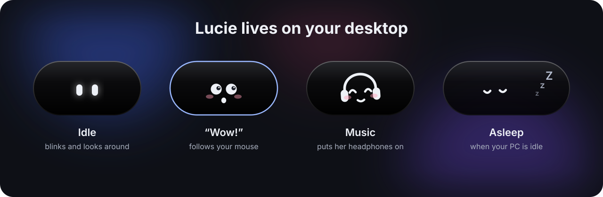

<div align="center">


# Lucie

**A tiny voice assistant that lives on your Windows desktop.**

Say *« Salut Lucie »*, then tell her what to do. She opens your apps, controls your music, mutes you on Discord and takes screenshots, and answers with soft little sounds instead of a voice.

[**⬇ Download the latest version**](https://github.com/iIINOBODYIIi/Lucie/releases/latest)

Windows 10 / 11 · 64-bit · free · works offline

<br>



</div>

---

## ✨ What she can do

- **🎙️ Wake word**: say *« Salut Lucie »* and she's listening. You can say it all in one go: *« Salut Lucie, ouvre Discord »*.
- **🫧 Hover menu**: move your mouse over Lucie to mute the mic, type a command or open the settings.
- **🖱️ Click or shortcut**: click the widget or press **Ctrl + Alt + L** (works in games too) to talk without the wake word.
- **🪟 Apps and their shortcuts**: *« Ouvre Cider »*, *« Montre-moi Discord »*. If the app is already open, even hidden in the tray, Lucie brings it to the front. Each app has its own voice shortcuts (*« Coupe mon micro »* → `Ctrl+Shift+M` in Discord). Record the keys in one click, then test them.
- **🎵 Music and volume**: play, pause, next, previous, volume up, down or mute. Works with Spotify, Apple Music, Cider, your browser, and more.
- **🎧 Live player**: when a song starts, the widget stretches to show the cover, title and controls, then tucks itself away.
- **🎮 Discord and Game Bar**: mute your mic, deafen yourself, start a screen recording, take a screenshot.
- **💜 “Listening to Lucie” on Discord**: your profile shows the song you're playing (title, artist, cover, progress bar and a button to listen), from Apple Music, your browser, VLC… or your iPhone over AirPlay.
- **👀 She feels alive**: she breathes, blinks, glances around, says *“wow”* and follows your mouse when it gets close, puts her headphones on when music plays, and falls asleep with little Z's when your PC is idle.
- **🔒 Private**: speech recognition runs **100 % offline** on your PC. Your voice never leaves it. (Only if you turn on the Discord status, the song title and artist are looked up in Apple's public music catalog to find the cover.)

## 🔊 AirPlay speaker

Lucie can turn your PC into an **AirPlay speaker** for your iPhone (this used to be the separate *Onde* app).

- Turn it on in **Settings › AirPlay**. Your PC shows up in the AirPlay list on your iPhone.
- A music widget shows the cover, title, artist and progress, with previous / play-pause / next buttons that control the iPhone.
- **10-band equalizer** with 12 presets, and **concert mode** (reverb + echo) with 6 venues: club, concert hall, stadium, cathedral, acoustic live, canyon.
- The widget can be **attached** (always on top), a normal **window**, or **pinned to the desktop**; hidden or shown; it hides itself during fullscreen games and videos; fully customisable (colours, glass / transparent background, opacity, corners, size).
- Lucie's music commands (« Musique suivante », « Pause »…) control the iPhone while it's connected.

| Say… | Lucie… |
| --- | --- |
| « Active le mode concert » · « Mode studio » · « Coupe le mode concert » | concert mode on / off |
| « Mets l'ambiance stade » · « Mode concert cathédrale » | picks a venue |
| « Augmente les basses » · « Baisse les aigus » · « Monte les médiums » | ±3 dB on the EQ |
| « Égaliseur rock » · « Mets le son hip-hop » · « Remets l'égaliseur à plat » | EQ presets |
| « Allume AirPlay » · « Coupe l'AirPlay » | speaker on / off |
| « Affiche le widget AirPlay » · « Cache le widget AirPlay » | widget |

> If your iPhone doesn't see the PC, click **Allow Lucie in the firewall** in Settings › AirPlay, and make sure your Wi-Fi network is set to *Private*.

## 🚀 Getting started

1. **Download** `Lucie-Windows-x64.zip` from the [latest release](https://github.com/iIINOBODYIIi/Lucie/releases/latest).
2. **Extract it** (right-click › *Extract All…*) somewhere it will stay, for example `Documents\Lucie`.
3. **Run `Lucie.exe`.**
   Windows may show a blue *“Windows protected your PC”* screen because the app isn't signed. Click **More info** › **Run anyway**.
4. On first launch, the settings open: click **Download automatically** to get the French voice model (~40 MB).
5. Say **« Salut Lucie »** 🎤

> 💡 Right-click the widget for the menu: **Talk to Lucie**, **Settings**, **Quit**.
> Hold the widget and move your mouse to place it anywhere on the screen.

## 🗣️ What to say

> Lucie understands **French**: the voice model is French. Every phrase can be changed in **Settings › Commands & shortcuts**, and you can add your own.

| Say… | Lucie… |
| --- | --- |
| « Ouvre / lance / montre-moi *app* » | opens the app, or brings it to the front |
| « Ouvre le navigateur » | opens your web browser |
| « Lance la musique » · « Mets pause » | plays / pauses the music |
| « Musique suivante » · « Musique précédente » | next / previous track |
| « Monte le son » · « Baisse le son » · « Coupe le son » | volume up / down / mute |
| « Fais une capture » | takes a screenshot (saved in *Pictures › Lucie*) |
| « Lance l'enregistrement » | starts / stops screen recording (Xbox Game Bar) |
| « Coupe mon micro » | toggles your Discord microphone |
| « Mets-moi en sourdine » | toggles Discord deafen |

### Just chatting

Lucie has no voice, so she answers with her face and a soft sound:

| Say… | Lucie… |
| --- | --- |
| « Salut, comment tu vas Lucie ? » · « Ça va ? » | winks 😉 |
| « Ça va bien » · « Super » | happy little jumps |
| « Bonjour » · « Coucou » | waves with a happy face |
| « Merci » · « Bravo » · « T'es la meilleure » | blushes |
| « Je t'aime » · « T'es mignonne » | heart eyes 😍 |
| « Oui » · « Tu m'entends ? » | nods |
| « Non » · « T'es nulle » | shakes her head |
| « Bonne nuit » | yawns and falls asleep |
| « Réveille-toi » · « Regarde » | surprised big eyes |

When she doesn't understand, she tilts her head, puzzled.

### Discord

**Recommended: connect Lucie to Discord** (*Settings › Discord*). She then mutes / unmutes your mic, deafens / undeafens and leaves the voice channel directly, through Discord's official local API — no keyboard shortcuts needed, and you can say exactly what you want (« Coupe mon micro » *or* « Réactive mon micro »).

Discord only lets registered apps control your microphone, so you create your own free Discord application once (2 minutes, guided in the settings): copy its *Client ID* and *Client Secret*, add `http://localhost` as a redirect, click **Connect**, then **Authorize** in Discord. Credentials are encrypted with your Windows account.

**Show what you're listening to.** With just the *Client ID* (no authorization needed), Lucie sets your Discord status to *Listening to Lucie* with the song title, artist, album cover, a progress bar and an *Écouter sur Apple Music* button. Turn it on or off in *Settings › Discord*, choose whether the member list shows "Lucie" or the song title, and skip Spotify (which already shows its own status). To show Lucie's logo next to the cover, upload her icon as `lucie` in your Discord application's *Rich Presence › Art Assets*.

**Without connecting**, Lucie uses keyboard shortcuts instead. In **Discord › Settings › Keybinds**, add:

| Discord action | Shortcut |
| --- | --- |
| Toggle Mute | `Ctrl + Shift + M` |
| Toggle Deafen | `Ctrl + Shift + D` |

## ⚙️ Settings

- **General**: her name (anyone can rename her), listening mode (*always ready* or *only when I activate her*), the talk shortcut, start with Windows.
- **Audio devices**: choose your microphone and output, with a live mic level meter.
- **Widget**: position (9 spots or drag-and-drop), size, transparency, sleep delay, mouse detection zone, live music player.
- **Look**: transparent settings window, accent colour.
- **Sounds**: on/off, volume, three sound themes.
- **Apps & shortcuts**: one card per app: the names you call it (e.g. `Cider / cidre`), the program, and its keyboard shortcuts with a **record** and a **test** button.
- **General commands**: music, volume, screenshot, links and Windows shortcuts, plus **the last sentence Lucie heard** to help you fine-tune.

## ❓ FAQ

<details>
<summary><b>Lucie doesn't react when I talk</b></summary>

- Check **Settings › Audio devices**: the mic level bar should move when you speak. If not, pick the right microphone.
- Make sure Windows allows desktop apps to use the microphone (*Settings › Privacy › Microphone*).
- Look at **the last sentence heard** in *Commands & shortcuts* to see how Lucie understood you.
</details>

<details>
<summary><b>She doesn't understand an app's name</b></summary>

The voice model may hear it differently (e.g. *Cider* → *cidre*). In **Settings › Apps**, add the way she hears it after a `/`: `Cider / cidre`.
</details>

<details>
<summary><b>Can I rename her?</b></summary>

Yes, in **Settings › General**. Pick a common first name so the voice model knows it well.
</details>

<details>
<summary><b>Where are my settings stored?</b></summary>

In `%LocalAppData%\Lucie`. To start fresh, quit Lucie and delete `settings.json` there.
</details>

---

## 🛠️ For developers

Built with **C# / WinUI 3** (Windows App SDK), **Vosk** for offline speech recognition and **NAudio** for audio.

<details>
<summary><b>Build from source</b></summary>

1. Install **Visual Studio 2022** with the **.NET desktop development** workload and **Windows App SDK C# Templates**.
2. Open `Lucie.sln`, select the **x64** platform, press **F5**.
3. To produce a release zip locally, run `Publier.bat`.

Releases are built automatically by GitHub Actions (`.github/workflows/publier.yml`): **Actions › Publier Lucie › Run workflow**.
</details>

<details>
<summary><b>Project layout</b></summary>

```
Lucie/
├─ App.xaml(.cs)              startup, shared services, crash report
├─ Assets/                    app icon
├─ Models/AppSettings.cs      settings, default commands and apps
├─ Native/Win32.cs            window shape, focus, mouse, idle time, hotkeys
├─ Services/
│  ├─ SpeechService.cs        microphone + Vosk (wake word, then command)
│  ├─ CommandInterpreter.cs   sentence → command or app
│  ├─ ActionExecutor.cs       runs a command
│  ├─ AppLauncher.cs          opens an app or brings it to the front
│  ├─ KeyboardSimulator.cs    sends keyboard shortcuts
│  ├─ HotkeyService.cs        global talk shortcut
│  ├─ MediaService.cs         now playing (Windows media controls)
│  ├─ SoundService.cs         soft synthesized sounds
│  ├─ ModelDownloader.cs      downloads the voice model
│  └─ …
└─ Views/
   ├─ LucieFace.xaml(.cs)     the animated face
   ├─ WidgetWindow.xaml(.cs)  the floating capsule + music player
   └─ SettingsWindow.xaml(.cs)
```
</details>
